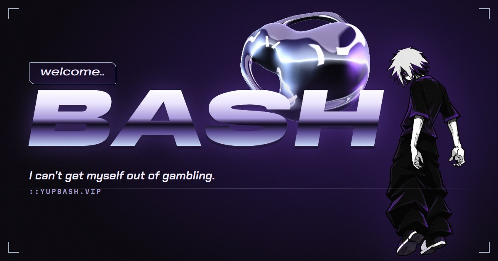
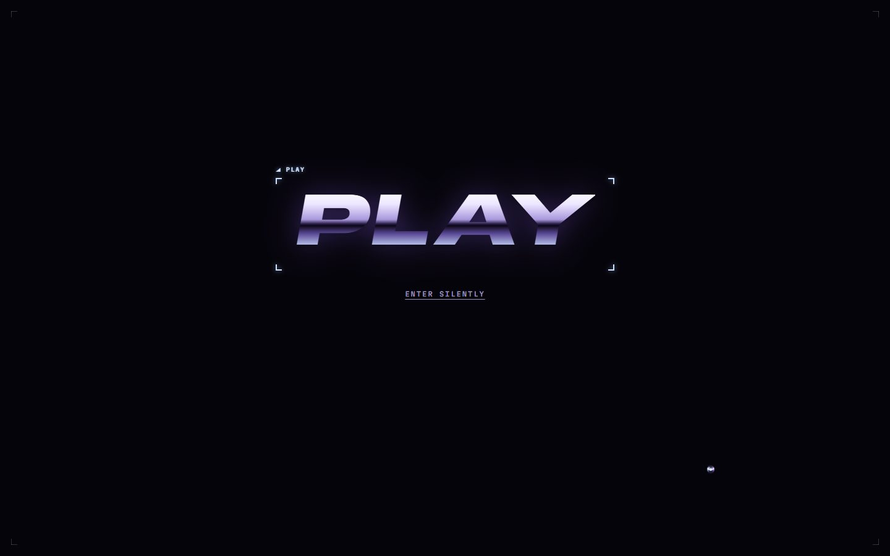
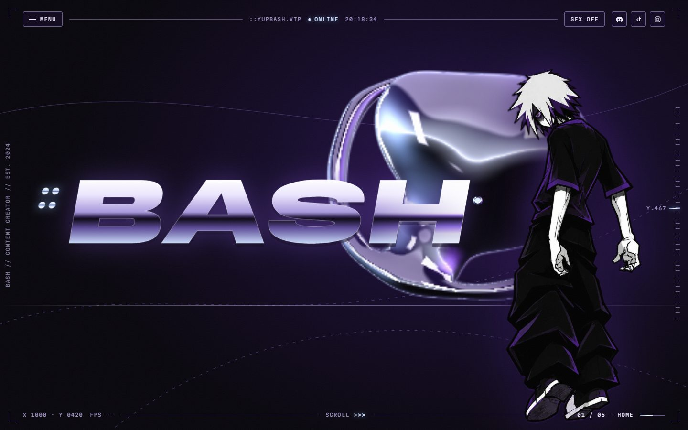
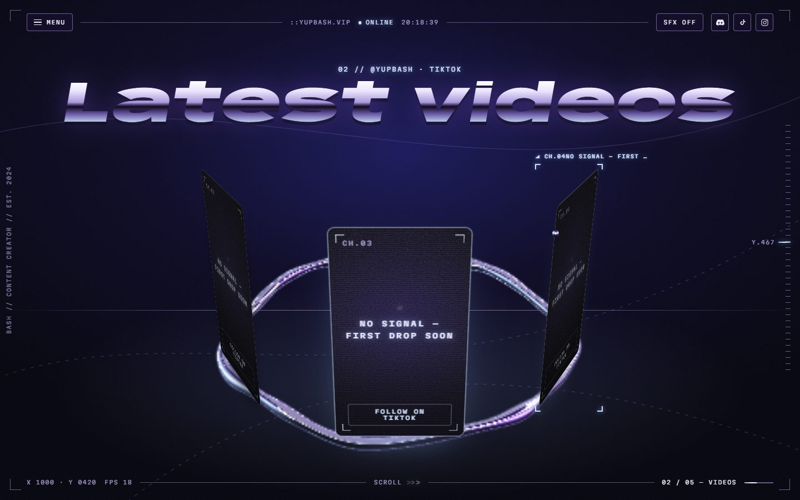
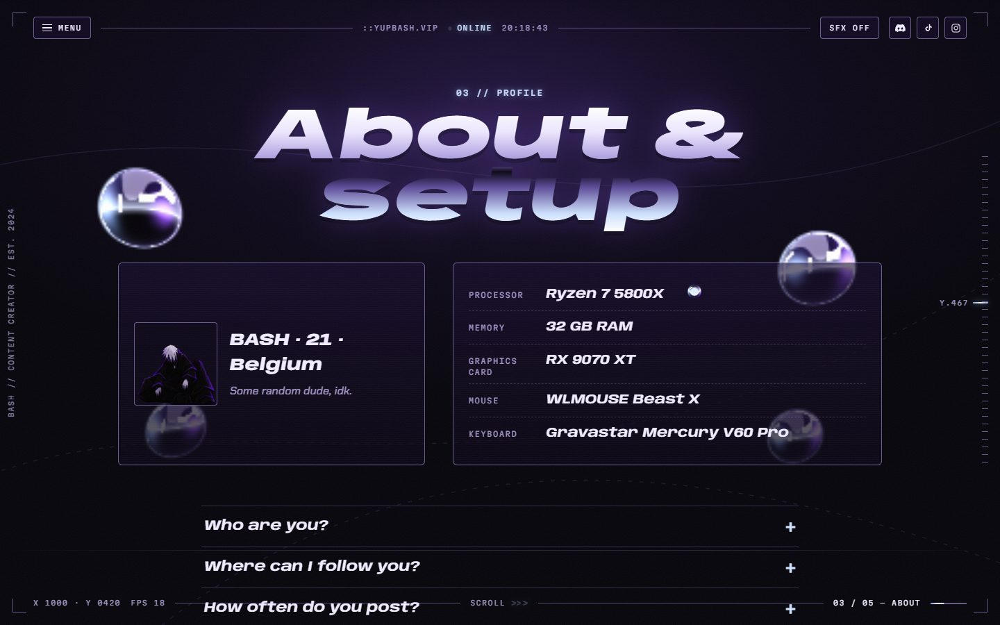
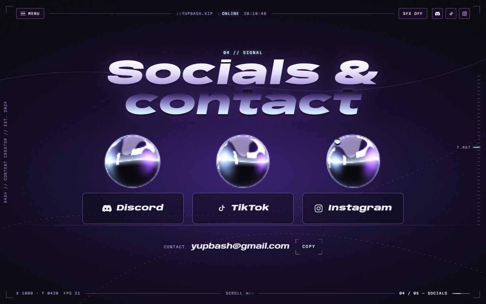
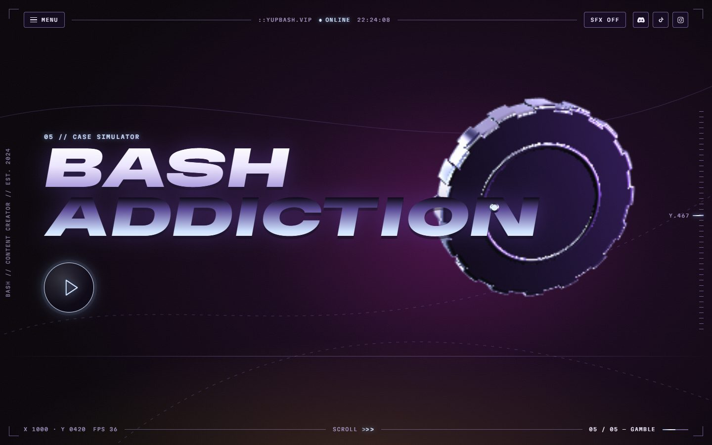
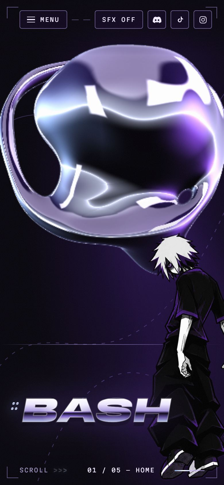
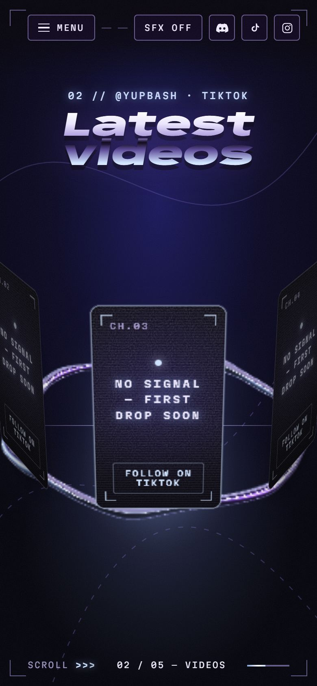
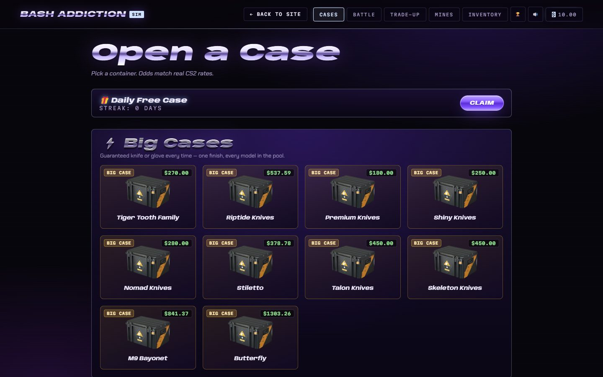

<div align="center">



# `::` BASH

**Créateur de contenu. Accro au gambling (le faux, promis).**
TikTok · Instagram · Discord — et un site qui ressemble à ce qui se passe dans ma tête.

[**yupbash.vip**](https://yupbash.vip) &nbsp;·&nbsp; [TikTok](https://www.tiktok.com/@yupbash) &nbsp;·&nbsp; [Instagram](https://www.instagram.com/yupbash) &nbsp;·&nbsp; [Discord](https://discordapp.com/users/852685497108267019)


</div>

---

## Qui est BASH ?

Moi, c'est **BASH** (aka *yupbash*) : 21 ans, Belge, *some random dude, idk.*
Je fais du contenu sur TikTok et Instagram, je traîne sur Discord, et j'ai un léger problème avec l'ouverture de caisses CS2.
Ce site, c'est ma carte de visite : mes réseaux, mes dernières vidéos, mon setup, et un simulateur de caisses pour se ruiner avec de **l'argent 100 % faux**.

---

## Le site : design v3 « Nocturne Chrome »

Une ambiance **Y2K futuriste** : du noir, du violet profond, une touche de **silver bleu** (`#cfe2ff`), du **chrome liquide en 3D** qui réagit à la souris et au scroll, et une interface façon **HUD** (fines lignes, coordonnées, horloge en direct). Tout est fait main : pas de template, pas de framework.

<table>
<tr>
<td width="50%"></td>
<td width="50%"></td>
</tr>
<tr>
<td><b>PLAY</b> — à la première visite, une intro de 2 s avec un son <i>entièrement synthétisé</i> (ou en silence).</td>
<td><b>01 · Home</b> — <code>::BASH</code> en lettres chromées, le perso, et une sculpture de chrome liquide qui suit la souris.</td>
</tr>
<tr>
<td></td>
<td></td>
</tr>
<tr>
<td><b>02 · Latest videos</b> — la sculpture devient un anneau, et les vidéos tournent dessus comme un carrousel au rythme du scroll.</td>
<td><b>03 · About & setup</b> — fiche perso, fiche technique qui se « décode », FAQ… et un démineur caché derrière le 💣.</td>
</tr>
<tr>
<td></td>
<td></td>
</tr>
<tr>
<td><b>04 · Socials & contact</b> — trois bulles de chrome, une par réseau, reflet aux couleurs de la marque au survol, e-mail copiable.</td>
<td><b>05 · Click to gamble</b> — le chrome se transforme en jeton de casino, et un bouton play mène au simulateur.</td>
</tr>
</table>

<table>
<tr>
<td width="36%"></td>
<td width="36%"></td>
<td>

### Sur téléphone

- Même expérience, pensée pour le pouce.
- La sculpture suit **l'inclinaison du téléphone** (gyroscope).
- Un fondu sous la barre HUD garde le haut de l'écran propre.
- Fluide même sur des téléphones modestes : la 3D adapte sa résolution en direct.

</td>
</tr>
</table>

### BASH ADDICTION — le simulateur de caisses (`/cases/`)



Ouvre des caisses CS2 avec les **vraies probabilités**, garde tes skins, fais des **trade-ups**, affronte un bot en **case battle**, tente ta chance aux **Mines**, et fais tourner un **clicker** pour te refaire. Drop légendaire animé, partage en format story, succès, récompense quotidienne.
Tout est sauvegardé **dans ton navigateur uniquement** : aucune vraie monnaie, aucun compte, aucun serveur.

---

## Les petits détails qui font tout

| | |
|---|---|
| 🫧 **Curseur « Mercure »** | Une goutte de chrome liquide remplace la souris, avec une traînée en comète. Sur un bouton, des crochets de verrouillage HUD l'encadrent avec son nom. |
| 🔊 **Sons maison** | Tic au survol, « bloop » au clic, souffle entre les sections, intro de démarrage : tout est généré en direct avec la Web Audio API, sans aucun fichier audio. Coupé par défaut, bouton `SFX` dans le HUD. |
| 🌌 **Fond vivant** | Le fond change d'ambiance à chaque section, en douceur, au fil du scroll. |
| 🧲 **Boutons magnétiques** | Les boutons principaux attirent légèrement le curseur. |
| 👆 **Easter eggs** | Clique 5 fois sur le perso. Trouve le 💣 dans la FAQ. Ouvre la console. |
| ♿ **Accessible** | Navigable au clavier, focus visible, contrastes vérifiés, « réduire les animations » respecté, tout le texte reste dans le HTML (lisible par Google). |
| 🛟 **Plans B** | Sans WebGL : image fixe de la sculpture. Sans GSAP : grille simple. Sans `localStorage` : tout marche quand même. |

---

## Sous le capot

- **100 % statique** sur GitHub Pages : HTML, CSS et JavaScript vanilla. **Pas de build, pas de npm, pas de framework.**
- **Chrome liquide** : un shader **WebGL écrit à la main** (raymarching de gouttes fusionnées, anneau, jeton de casino), avec un environnement de studio procédural. La résolution s'adapte en direct à la puissance de l'appareil.
- **Scroll** : défilement lissé maison et GSAP ScrollTrigger (cdnjs, avec hash SRI) pour le carrousel.
- **Sécurité** : une Content-Security-Policy sur chaque page, aucune donnée envoyée nulle part, et les titres venant de fichiers de données sont insérés en texte (jamais en HTML).
- **Tests** : plus d'une centaine de tests automatiques (Python + Playwright) dans un vrai navigateur. Ils vérifient les textes exacts, le WebGL, le clavier, les contrastes, le poids de la page, les liens et les plans B.

### Arborescence

```
/
├── index.html              Accueil : toutes les sections (écran PLAY, Home, Videos, About, Socials, Gamble, fin)
├── 404.html                Page d'erreur (« 404 » en chrome)
├── socials/, faq/          Anciennes pages → redirigent vers /#socials et /#about
├── cases/                  BASH ADDICTION, le simulateur de caisses (index.html + données JSON)
├── assets/
│   ├── css/tokens.css      Couleurs, polices, easing (variables --nc-*)
│   ├── css/base.css        Socle commun : HUD, menu, boutons, écran PLAY, curseur, fond
│   ├── css/home.css        Les sections de l'accueil
│   ├── css/cases.css       Le thème Nocturne Chrome du simulateur
│   ├── js/site.js          BashSite : stockage sûr, HUD en direct, menu, écran PLAY + intro
│   ├── js/chrome.js        BashChrome : la sculpture WebGL et ses états par section
│   ├── js/mercure.js       BashMercure : le curseur goutte de chrome + crochets de verrouillage
│   ├── js/home.js          BashHome : parcours au scroll, carrousel vidéo, fiche, contact, inclinaison
│   ├── js/audio.js         BashAudio : les sons synthétisés
│   ├── js/minesweeper.js   BashMines : le démineur caché
│   ├── videos/videos.json  Les vidéos de la section « Latest videos »
│   └── chrome-fallback.webp, og-image.jpg, character.webp, faq-character.webp, icônes…
├── tools/                  add-video.py, render-assets.py, og.html (non publiés)
├── tests/                  Les tests automatiques (non publiés)
└── docs/                   Spec, plan de travail, captures du README (non publiés)
```

### Les états du chrome

La sculpture change de forme à chaque section, avec un fondu continu au fil du scroll :

| Section | Forme |
|---|---|
| Home | gouttes fusionnées + anneau en orbite, un « bras » qui suit la souris |
| Latest videos | les gouttes fondent, l'anneau s'agrandit et devient la piste du carrousel |
| About & setup | petites gouttes rangées dans les marges |
| Socials & contact | trois bulles séparées, une au-dessus de chaque bouton |
| Click to gamble | un jeton de casino qui tourne |
| Fin | une dernière goutte au-dessus du titre |

---

## Travailler sur le site

**Lancer en local** (obligatoire pour les fichiers JSON) :
```bash
python -m http.server 8000      # puis http://localhost:8000
```
Pour revoir l'écran PLAY, utilise une fenêtre de navigation privée : il ne s'affiche qu'à la première visite.

**Ajouter une vidéo TikTok** (elle remplace une carte « NO SIGNAL ») :
```bash
python tools/add-video.py https://www.tiktok.com/@yupbash/video/1234567890
```
Le script récupère le titre et la miniature, et garde une copie locale de la miniature (les images hébergées chez TikTok seraient bloquées par la CSP).

**Régénérer l'image de partage et l'image de secours du chrome** :
```bash
python tools/render-assets.py
```

**Lancer les tests** (Python 3 + `pip install playwright` + `playwright install chromium`) :
```bash
python -m unittest discover -s tests -v
```

**Mémoire du navigateur** (`localStorage`, rien n'est envoyé) :

| Clé | Rôle |
|---|---|
| `bash_v3_entered` | `"1"` après l'écran PLAY (il ne revient plus) |
| `bash_v3_sfx` | `"on"` / `"off"` : sons activés |
| `bash_v3_tilt` | `"granted"` / `"denied"` : autorisation du gyroscope (iPhone) |
| `cs2sim_*` | sauvegarde du simulateur (solde, inventaire, stats, succès…) |

**Publier** : un push sur `main` met le site à jour en 1 à 2 minutes sur https://yupbash.vip (GitHub Pages).
**Revenir en arrière** : les anciens designs sont gardés dans les tags `design-v1` et `design-v2` (`git revert` du merge, ou redéployer un tag).

### Règles du projet

- Toute ressource externe (CDN, police, API) doit être ajoutée à la **CSP de chaque page**, sinon elle est bloquée.
- Toute donnée qui n'est pas écrite en dur s'insère avec `textContent` (ou `esc()` dans le simulateur), jamais en HTML brut.
- Les commits sont signés **YupBash** uniquement, sans ligne `Co-Authored-By`.

### Sécurité (historique)

- **2026-10 — Audit** : XSS via `innerHTML` corrigée dans le simulateur (`esc()`), CSP et Referrer-Policy ajoutées sur toutes les pages. Points connus : `frame-ancestors` est impossible en `<meta>` sur GitHub Pages, et le solde du jeu est modifiable en console (sans enjeu : aucune vraie monnaie).
- **2026-11 — Design v3** : la CSP n'a pas changé (aucune nouvelle ressource externe), les titres de vidéos sont insérés en texte, et les liens TikTok des vidéos sont vérifiés.

---

<div align="center">
<sub>Design & code : <b>BASH · 2024–2026</b> &nbsp;·&nbsp; fake money, real addiction.</sub>
</div>
